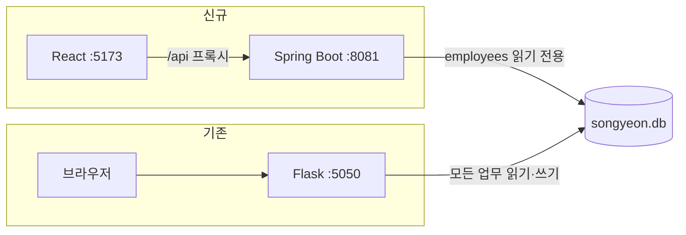

# 01. 프로젝트 개요와 폴더 구조

최종 정리: 2026-09-18

## 1. 한 줄 요약

송연(식품·소스 제조사)의 사내 업무 통합 시스템(MES/ERP)을 **Python Flask + SQLite + 순수 JS** 에서 **Spring Boot(Java 17) + React(TypeScript)** 로 옮기는 중이다. 구조 기준은 사내 참조 프로젝트 `D:\workspace\s-erp-main`이다. 현재 로그인·세션·공통 레이아웃·대시보드 달력·제품등록 입력 화면(저장 없음)까지 옮겼고, 업무 로직(제품·견적·생산·재고·출하·회계 등)은 아직 모두 Flask에 있다.

## 2. 최상위 폴더

```text
송연/
├─ MES_프로토타입_20260916/   기존 시스템 (Flask). 전환 기준이자 비교 대상. 수정하지 않음
├─ backend/                  신규 Spring Boot 3.5.16 / Java 17 — 현재 인증 API만 있음
├─ frontend/                 신규 React 19 + TypeScript + Vite — 로그인·레이아웃·대시보드·제품등록(미리보기)
├─ docs/                     이 문서들
│  ├─ reference/             자동 생성 부록 (API·DB·화면·테스트 목록)
│  ├─ screenshots/           E2E 테스트가 찍는 화면 이미지
│  └─ _tools/                부록 생성 도구 (inventory.py, read_design.py)
├─ .tools/                   프로젝트 전용 JDK 17 (Temurin 17.0.20.1) + 설치 zip
├─ venv/                     기존 Flask용 Python 가상환경 (부록 생성 도구 실행에도 사용)
├─ .github/modernize/        VS Code Java 업그레이드 확장이 만든 기록 훅 — 프로젝트 코드 아님
└─ .gitignore                `.tools/`만 제외. 송연 폴더 자체는 git 저장소가 아님
```

## 3. 기존 시스템 — `MES_프로토타입_20260916/`

```text
MES_프로토타입_20260916/
├─ app.py              5,987줄. Flask 생성, 요청 훅, 핵심 업무 API 153개(기준정보·견적·생산·재고·구매·출하·인사·창고·거래처·설정)
├─ auth.py             로그인·세션·비밀번호 (API 5)
├─ permissions.py      메뉴 권한 키 ↔ API 경로 권한표, 요청 전 권한 검사
├─ accounting.py       회계: 계정과목·계좌·카드·입출금·매출매입·채권채무 (API 25)
├─ sales.py            판매등록·판매현황 (API 6)
├─ recipe.py           레시피 작성·버전·공유·인계 (API 21)
├─ label.py            식품표시 라벨: 버전·양식·요청·출력 (API 32)
├─ attachments.py      문서함·첨부·공유·잠금 (API 17)
├─ chat.py             사내 메신저 (API 12)
├─ ai.py               Gemini/Anthropic 기반 AI 분석 (API 5)
├─ temperature.py      RadioNode 온습도 센서 (API 14)
├─ common.py           단가·BOM·재고 원장·집계 공통 함수
├─ schema.py           2,428줄. 기동 시 테이블 생성·컬럼 보정·초기 데이터
├─ config.py / db.py / secrets_store.py   설정, SQLite 연결(WAL), 외부 API 키 암호화(Fernet)
├─ import_data.py      Excel 기준정보 가져오기
├─ templates/          pricing.html(4,646줄, 메인 SPA 형태 화면), login.html, tv_production.html, tv_logistics.html
├─ static/js/          01-core.js ~ 39-material-substitute.js (39개, 전역 함수 방식)
├─ static/             app.css, vendor(SheetJS·JsBarcode), PWA manifest·service-worker, 이미지
├─ data/               songyeon.db, sample.db, schema.sql, secret.key  ※ 값은 문서에 옮기지 않음
├─ tests/              독립 실행형 검사 49개 (run_tests.bat은 36개만 실행)
├─ tools/              백업·샘플 DB·스키마 덤프·vendor 다운로드·설계문서 생성
└─ docs/               과거 자료: DB이사계획.md, 송연_생산관리_설계도.docx (2026-08-31 기준, 현재와 다름)
```

규모: HTTP 메서드·경로 조합 **290개**(이 중 `/api/` 286개, 고유 경로 227개), DB 테이블 **60개 / 컬럼 614개**, 선언된 FK **0개**, 화면 컨테이너(`screen-*`) 43개. 상세는 [reference/api-inventory.md](reference/api-inventory.md), [reference/database-schema.md](reference/database-schema.md), [reference/ui-and-test-inventory.md](reference/ui-and-test-inventory.md).

## 4. 신규 시스템

### backend/ — Spring Boot

```text
backend/
├─ pom.xml             spring-boot-starter-parent 3.5.16, web, security, sqlite-jdbc 3.50.3.0, bcprov(scrypt) 1.81
├─ run.cmd             JDK 선택 후 run | test | package | e2e
├─ src/main/java/kr/co/songyeon/mes/
│  ├─ MesApplication.java
│  └─ auth/            인증 관련 9개 클래스 (Controller, SecurityConfig, 계정 Repository, 비밀번호 검증, 시도 제한, 오류 처리)
├─ src/main/resources/application.yml   포트 8081, 세션 쿠키, SNAKE_CASE JSON, 계정 DB 경로
└─ src/test/           인증 통합·단위 테스트 5종 + E2E용 기동 클래스(임시 DB)
```

### frontend/ — React

```text
frontend/src/
├─ main.tsx · App.tsx
├─ routes/             AppRouter(경로 분기), AuthenticatedRoute(세션 확인), pageRegistry(메뉴ID → 페이지)
├─ pages/
│  ├─ auth/            LoginPage + LoginForm + useLoginForm
│  ├─ dashboard/       DashboardPage + 달력·메모 팝업 + 기념일 JSON
│  └─ sa/sa0001/  SA0001Page + components·hooks·store·types
├─ shared/             Dialog, MainLayout(사이드바·탭·테마), useSession, authService, navigation(메뉴·권한), 타입
└─ styles/             global·auth·common CSS
```

테스트는 `frontend/tests/*.spec.ts`(Playwright 13개). 상세 구조와 작성 규칙은 [06. 신규 시스템 구조](06-new-system.md).

## 5. 기술 스택 비교

| 영역 | 기존 | 신규 (현재) | 신규 목표 / 미정 |
|---|---|---|---|
| 서버 | Flask 3.1.3 + Waitress 3.0.2 | Spring Boot 3.5.16, Java 17, 내장 Tomcat | 전자정부 5.0 실행환경 적용 여부 미정 |
| 화면 | Jinja HTML 1장 + 전역 JS 39개 | React 19.3 + TypeScript 7.0 + Vite 8.3 | React Router·UI 라이브러리(MUI 등)·그리드 미도입 |
| DB | SQLite (WAL, busy_timeout 8s), 직접 SQL | 같은 SQLite를 **계정 조회만 읽기 전용** JDBC로 사용 | **PostgreSQL 확정**(신규 DB 생성 후 SQLite 자료 이관, s-erp와 같은 DB). MyBatis 권장 |
| 인증 | Flask 서명 쿠키 세션 | Spring Security 세션 쿠키 + CSRF | s-erp는 JWT — 차이 유지 여부 결정 필요 |
| 비밀번호 | Werkzeug scrypt / pbkdf2 | 같은 해시를 Java에서 검증 (호환) | |
| 권한 | 권한 키 문자열 배열(`employees.permissions` JSON) + 경로 권한표 | 메뉴 표시만 권한 키로 필터 | 업무 API마다 서버 권한 검사 구현 필요 |
| 파일 | `uploads/`, `chat_files/` 로컬 폴더 | 없음 | s-erp는 MinIO 사용 |
| 테스트 | 독립 Python 스크립트 49개 | JUnit 12 + Playwright 13 | |

## 6. 두 시스템의 관계 (현재)



- 신규 시스템은 Flask를 호출하지 않는다. 신규로 옮긴 기능(로그인·대시보드)만 쓸 때는 Python이 필요 없다.
- 두 시스템의 세션은 호환되지 않는다. 각각 따로 로그인한다.
- 업무 기능은 아직 Flask에만 있으므로, 실제 업무는 여전히 Flask 화면에서 한다.

## 7. 문서 작성 원칙

- 기존 코드에 대한 설명은 소스 근거(`파일:줄`)를 붙였다. 줄 번호는 2026-09-16 전달본 기준이다.
- DB 파일은 읽기 전용으로 구조만 확인했다. 업무 데이터·비밀번호·API 키·`secret.key` 값은 읽거나 옮기지 않았다.
- "제안", "미정"으로 표시한 항목은 사용자 결정이 필요한 사항이다.
