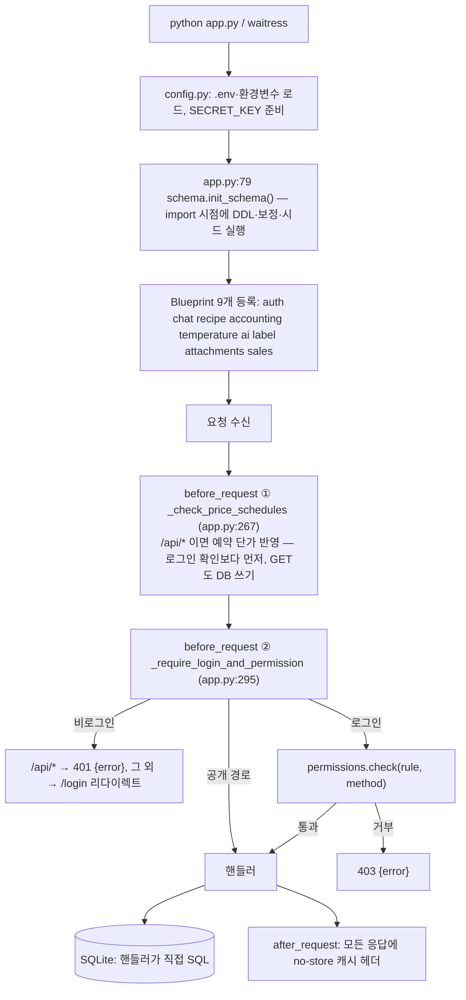

# 02. 기존 시스템(Flask) 구조 — 요청 흐름·인증·권한·설정·스키마

최종 정리: 2026-09-18 · 근거 줄 번호는 `MES_프로토타입_20260916/` 기준

업무별 규칙은 [03. 업무 규칙](03-business-rules.md), 화면별 매핑은 [04. 화면·메뉴 매핑](04-screen-map.md)에 있다. 이 문서는 모든 업무에 공통으로 걸리는 뼈대를 다룬다.

## 1. 기동과 요청 처리 흐름

| 단계 | 내용 | 근거 |
|---|---|---|
| 설정 | `.env` → OS 환경변수 우선. HOST 기본 `0.0.0.0`(사내망 접속), PORT 5050 | config.py:34-108 |
| 스키마 | 기동(정확히는 import)할 때마다 `init_schema()`가 CREATE·ALTER·보정·시드를 실행 | app.py:79, schema.py:2344 |
| 예약 단가 | 모든 `/api/*` 요청 앞에서 적용일이 된 원재료 단가 예약을 반영하고 BOM·단가표까지 연쇄 갱신 | app.py:242-271 |
| 인증·권한 | 공개 경로 판정 → 세션 확인(12시간 롤링 연장) → 권한표 검사 | app.py:295-331 |
| 핸들러 | 계층 분리 없음(Controller·Service·Repository 구분 없이 함수 하나에 SQL) | |
| 실행 | waitress `threads=100`, 없으면 Flask 개발 서버 | app.py:5977-5987 |
| 오류 처리 | 전역 `errorhandler` 없음. 검증 실패는 `{"error": "..."}` + 400/403/404/409, 예외는 500 | |

## 2. DB 접근 관례 (db.py)

- `get_conn()`: `timeout=10`, `PRAGMA journal_mode=WAL`, `busy_timeout=8000`. 대부분 핸들러가 `conn = get_conn()` → 작업 → `commit` → `close`이며 **try/finally가 거의 없다**.
- Python sqlite3 기본 모드라 **첫 DML 직전에만 BEGIN**이 걸린다. 그 전의 SELECT는 트랜잭션 밖에서 읽는다(재고 갱신 유실의 원인, [03 문서](03-business-rules.md) 참고).
- 명시적 `BEGIN IMMEDIATE`는 생산 등록, 출하 등록, 원재료 치환, 이월, 수주 채번, 원재료 생성, 거래처 엑셀 등 일부에만 있다.
- **검증 실패 시 롤백은 "commit하지 않고 close"에 의존한다.** Spring `@Transactional`에서 오류 응답을 `return`하면 그때까지의 쓰기가 commit되므로, 이식할 때는 반드시 예외로 바꿔야 한다.
- `query()`는 호출할 때마다 새 연결을 연다. 수불대장처럼 여러 쿼리를 합치는 조회는 일관된 스냅샷이 아니다.
- 선언된 FK는 **0개**. 테이블 사이는 id 또는 **이름 문자열**(거래처명, 창고명, 제품 표시명 `이름(규격)`)로 연결된다.

## 3. 인증

### 3-1. 세션

| 항목 | 기존 Flask | 신규 Spring (현재) |
|---|---|---|
| 방식 | 서명된 클라이언트 쿠키(암호화 안 됨, 서버 저장소 없음) | 서버 메모리 세션 + 쿠키 `SONGYEON_SESSION` |
| 쿠키 이름 | `songyeon_{PORT}` | `SONGYEON_SESSION` |
| 만료 | 12시간, 요청마다 연장 | 12시간 유휴 |
| HttpOnly / SameSite / Secure | O / Lax / `SONGYEON_HTTPS=1`일 때 | 같음 |
| CSRF | **없음** (SameSite에만 의존) | Spring Security CSRF 토큰(세션 저장, `GET /api/csrf`로 발급) |
| 세션 내용 | employee_id, name, department, permissions, is_admin, recipe_permission — **로그인 시점 스냅샷** | `SessionUser`(id, username, name, department, permissions, admin, recipe_permission, password_is_default) |
| 강제 로그아웃 | 불가(계정 회수해도 쿠키가 12시간 유효) | 서버 세션이라 구현 가능(미구현) |

권한 변경·계정 회수·퇴사가 즉시 반영되지 않는 문제는 신규에서도 로그인 시점 스냅샷이라 그대로다. 요청마다 권한을 다시 조회할지 결정이 필요하다.

### 3-2. 비밀번호·로그인

- 해시: Werkzeug `scrypt:32768:8:1$salt$hex`(기본), 옛 계정은 `pbkdf2:sha256:N$salt$hex`. **채팅방 비밀번호·문서 폴더 잠금도 같은 형식**이다. 신규 `WerkzeugPasswordVerifier`가 두 형식을 검증한다.
- 기본 비밀번호: `SONGYEON_DEFAULT_PASSWORD`, 없으면 `changeme`. 시드 관리자 계정이 이 값으로 생성된다.
- 비밀번호 변경 `POST /api/me/password`: 8자 이상, 기본값·현재값과 다를 것. 관리자 계정 설정·사원 생성에는 길이 검사가 없다.
- 로그인 시도 제한: IP 기준, 5회 60초 / 10회 5분 / 20회 30분, 메모리 저장. 기존 코드는 마지막 실패 15분 뒤 기록을 지워서 **30분 잠금이 15분에 풀리는 버그**가 있다(auth.py:76). 신규 `LoginAttemptLimiter`는 이 버그가 없다.
- **퇴사자(`resign_date`)도 로그인된다.** 기존·신규 모두 검사하지 않는다.

### 3-3. 인증 API

| API | 기존 응답 | 신규 구현 |
|---|---|---|
| `POST /api/login` | `{ok}` / 401 / 429 `{error, locked_seconds}` | 동일 + `Retry-After` 헤더, CSRF 필수 |
| `POST /api/logout` | `{ok}` | 동일, CSRF 필수 |
| `GET /api/me` | id, name, department, permissions, is_admin, recipe_permission, password_is_default(**호출마다 scrypt 비교**), **shared_recipe_count, shared_document_count** | shared_* 두 필드 없음, username 추가, password_is_default는 로그인 때 1회 계산 |
| `POST /api/me/password` | 비밀번호 변경 | **미구현** |
| `GET /api/csrf`, `GET /api/health` | 없음 | 신규 |

`shared_*_count`는 공유받은 레시피·문서가 있을 때 메뉴를 여는 데 쓰인다. 문서함·레시피 화면을 옮길 때 `/api/me`에 추가해야 한다.

## 4. 권한 모델

### 4-1. 판정 순서 (permissions.py:492-513)

1. 경로 템플릿(예: `/api/sales-order/<int:sid>`)이 **PUBLIC / COMMON / SELF_CHECKED** 중 하나면 통과
2. `RULES[(경로 템플릿, 메서드)]`가 없으면 **로그인만 확인하고 통과 (fail-open)** — 현재 290개 라우트 중 누락은 0건
3. `is_admin`이면 통과
4. `"ADMIN_ONLY"`면 403
5. 사용자 권한 키 목록과 요구 목록이 **하나라도 겹치면 통과(any-of)**

- 경로 매칭은 **정확 일치**다(prefix 없음). prefix는 로그인 면제 판정(`/login`, `/api/login`, `/tv/`, `/static/`로 **시작**하면 공개)에만 쓰여, `/api/login-xxx` 같은 새 경로가 생기면 공개되는 구멍이 있다.
- Flask가 GET에 자동으로 붙이는 **HEAD는 권한표에 없어 검사 없이 실행**된다.
- 핸들러 안 추가 검사: 회계의 `kind`(매출/매입, 입금/출금, 채권/채무), 문서함의 scope·부서·소유자·공유, 레시피 등급, 메신저 방 멤버·비밀번호.

| 분류 | 경로 |
|---|---|
| PUBLIC | `/login`, `/api/login`, `/tv/production`, `/tv/logistics`, `/static/*` |
| COMMON (로그인만) | `/`, `/api/me`, `/api/me/password`, `/api/logout`, `/api/summary`, `/api/holidays`, `/api/charter-summary`, `/api/clients`, `/api/clients/vendor-names`, `/api/products/client-names`, `/api/products/next-code`, `/api/materials/names`, `/api/materials/last-price`, `/api/dashboard-memos(/<id>)` |
| SELF_CHECKED | 레시피 API 대부분, `/api/document-shares/mine`, `/api/attachments/<id>/download` |
| ADMIN_ONLY | 사원 삭제, 계정 설정·회수, 서버설정 조회·저장 |

### 4-2. 권한 키 (54개, `employees.permissions` JSON 배열)

| 분류 | 키 |
|---|---|
| 영업관리 | `product` `pricing` `quote` `order` `shipment` `prod-check` |
| 판매관리 | `sales-register` `sales-status` `sales-total` |
| 공통관리 | `settings-packaging` `settings-packingmethod` `settings-vehicle` `settings-warehouse` `settings-pbom` `settings-client` `settings-clientproduct` `settings-material` `settings-server` `production` `logistics` |
| 생산관리 | `prod-confirm` `actual` `prod-status` `label-print` |
| 물류관리 | `product-stock` `ship-confirm` `ship-status` |
| 구매관리 | `po` `recv` `mat-sub` `purchase` `stock` `wh-move` `stock-status` `documents` |
| 품질관리 | `label-register` `temp-monitor` |
| 상품개발 | `recipe-write` `recipe-share` `recipe-log` — **서버는 보지 않음**. 실제 판정은 `recipe_permission` |
| 인사·회계 | `hr` `employees` `acc-basic` `acc-sales` `acc-purchase` `acc-tx` `acc-in-report` `acc-out-report` `acc-receivable` `acc-payable` `tax-invoice` `delivery-statement` |
| 메신저·AI | `chat` `ai-chat` |

키별로 열리는 API 목록은 [04. 화면·메뉴 매핑](04-screen-map.md)과 `permissions.py` RULES를 기준으로 한다. 자주 쓰이는 묶음: `_BOM_VIEWERS`, `_LABEL_VIEWERS`, `_MATERIAL_VIEWERS`, `_CLIENT_VIEWERS`, `_ACC_ANY` (permissions.py:89-100).

**`recipe_permission`**: `viewer`(1) < `download`(2) < `upload`(3) / null. 관리자는 무조건 통과. 값이 있으면 레시피 메뉴 3개가 모두 열린다.

**화면 전용 별칭** (03-shell.js:85-106, 신규 `navigation.ts`에도 동일 구현). 서버는 원래 키만 보므로 메뉴는 열리지만 API는 403이 날 수 있다:

| 가진 키 | 추가로 보이는 메뉴 | 이유 |
|---|---|---|
| `wh-move` | `stock` | 재고조정 화면 안의 창고이동 탭 |
| `employees` | `hr` | 인사관리 화면의 계정 탭 |
| `acc-payable` / `acc-purchase` / `acc-out-report` | `acc-receivable` / `acc-sales` / `acc-in-report` | 같은 화면의 다른 탭 |
| `settings-*` 중 하나 | `settings` | 기초정보 메뉴(탭은 키별 필터) |
| `recipe_permission` 있음 | 레시피 3개 메뉴 | |
| `shared_recipe_count > 0` / `shared_document_count > 0` | 공유 레시피 / 문서함(공유 탭만) | **신규 미반영** |

### 4-3. 권한표의 알려진 불일치

- `settings-server` 키는 효과 없음(서버설정은 ADMIN_ONLY). `employees` 키는 사실상 조회 전용(계정 쓰기는 관리자만).
- `GET /api/employees`는 `hr`만 있어도 username·permissions·is_admin까지 반환한다(인사/계정 분리 취지와 다름).
- `mark-imported`는 `order`, `production`만 허용하는데 물류 화면도 `target=shipment`로 호출한다 → `logistics`만 가진 사용자는 403, 수주가 계속 "미가져감"으로 남는다.
- TV 화면(PUBLIC)이 부르는 `/api/production-schedule`, `/api/logistics-schedule`은 로그인이 필요하다. TV 브라우저가 권한 있는 계정으로 로그인돼 있어야 동작한다.

**Spring 이식 기준**: 권한표를 `(HttpMethod, 경로)` → `hasAnyAuthority(...)`로 옮기고, 미등록 경로는 **거부(denyAll)** 가 기본이다(신규 SecurityConfig가 이미 그렇다). HEAD도 GET과 같은 권한을 요구한다. 관리자 우회, kind별 재검사, 문서·레시피 개체 단위 검사는 서비스 계층에서 한다.

## 5. 설정과 비밀값

| 항목 | 출처 / 기본값 | 비고 |
|---|---|---|
| `SECRET_KEY` | `SONGYEON_SECRET_KEY` → `data/secret.key` → 없으면 생성 | 세션 서명 + **Fernet 키 유도에 같은 값 사용** |
| `DB_PATH` | `SONGYEON_DB_PATH` → `data/songyeon.db` | `run_dev.py`(5051)도 **운영과 같은 DB·키**를 씀 |
| `DEFAULT_PASSWORD` | `SONGYEON_DEFAULT_PASSWORD` → `changeme` | |
| `HOST` / `PORT` | `0.0.0.0` / 5050 | 신규 Spring은 `127.0.0.1:8081` |
| `SESSION_COOKIE_SECURE` | `SONGYEON_HTTPS=1` | |

**Fernet 암호화 (secrets_store.py)**: 키 = `base64url(SHA-256(SECRET_KEY))`. 저장 형식은 `"enc:" + 토큰`이다. 복호화에 실패하면 **빈 문자열**을 돌려준다(오류 없이 값이 사라진 것처럼 보임).

| 암호화 대상 | 비고 |
|---|---|
| `external_api_settings.api_key`, `api_secret` | Gemini, Anthropic, RadioNode, 팝빌, 고도몰 |
| `employees.resident_no_enc` | 주민번호 13자리. 목록에는 `YYMMDD-N******`만 노출, 전체 조회는 hr 권한 + 별도 API, 조회 기록은 stdout에만 |

→ SECRET_KEY를 바꾸거나 잃으면 세션, API 키, **주민번호**가 동시에 사라진다. Java 이관 시 이 키 원본으로 복호화 후 재암호화해야 하며, 세션 키와 암호화 키를 분리할 것을 권장한다.

## 6. schema.py — 기동할 때마다 실행되는 작업

`init_schema()`는 `ensure_*` 함수들을 정해진 순서로 호출한다. 테이블 60개, 인덱스 39개 + 동적 5개. 도메인별 테이블 목록은 [03 문서 부록](03-business-rules.md#부록-도메인별-테이블)에 있다.

### 시드 데이터

| 시드 | 조건 |
|---|---|
| 관리자 계정 (username `관리자`, 관리팀, 기본 비밀번호, is_admin=1) | `username='관리자'` 행이 없을 때 |
| external_api_settings 5행 (radionode, anthropic, gemini, popbill, godomall — 키는 빈 값) | INSERT OR IGNORE |
| label_company_info id=1 빈 행 | 없을 때 |
| warehouses: 계량창고, 자재창고(입고창고) | 비었을 때 |
| acc_subject 계정과목 32개 (101 현금 ~ 831 지급수수료) | 비었을 때 |

### 매 기동 보정 (★는 운영 데이터를 바꿀 수 있어 위험)

| # | 작업 |
|---|---|
| ★ | `clear_stale_lot_shipped_tally`: 미확정 출하가 가리키는 생산행의 `logistics_actual_qty`를 매번 NULL로 지움 |
| ★ | `ensure_admin_account`: 관리자 아이디를 바꾸면 재기동 때 기본 비밀번호 관리자가 **하나 더 생김** |
| ★ | acc_transaction: `[옛 입금표]` 전표가 0건이면 client_payments 전체를 다시 옮김(지운 이행 전표가 부활) |
| | lot_no 소급 부여, product_code 소급 연결(이름이 유일할 때만), 창고명 `계량`→`계량창고` 치환, 입고 창고·과세구분 기본값, 공급처 테이블 이행(지운 공급처 부활 가능), 라벨 v1 생성(지운 버전 부활 가능), 평문 API 키 암호화, 레시피 거래처 폴더 생성 |

**신규 방침**: 이 보정들은 Flyway 같은 버전별 마이그레이션 1회 실행으로 옮기고, 애플리케이션 기동 시에는 실행하지 않는다. 신규 백엔드는 현재 스키마를 전혀 건드리지 않는다(읽기 전용).

## 7. 외부 연동과 부가 기능

| 대상 | 방식 | 상태 |
|---|---|---|
| Gemini / Anthropic | ai.py에서 HTTP 호출, 키는 서버설정(암호화) | 키가 있어야 동작, 실사용 검증 안 함 |
| RadioNode(타파쿨로365) | temperature.py, 온습도 센서 조회 | 실제 장비 검증 필요 |
| 팝빌 세금계산서 | 설정 항목만 있음 | 발행 API는 **501 미구현** |
| 고도몰 | 설정 행만 있음 | 사용 코드 확인 필요 |
| Daum 우편번호 | pricing.html이 외부 스크립트 로드 | 인터넷 필요 |
| 파일 저장 | DB 폴더 아래 `uploads/`, `chat_files/` | DB만 옮기면 파일 누락 |
| PWA | manifest + 네트워크 우선 서비스워커 | 오프라인 업무 기능 아님 |
| 공휴일 | app.py에 2025~2027 하드코딩 | 2028년부터 빈 목록. 신규 달력도 같은 JSON |

## 8. 이 문서에서 도출한 이식 원칙 (요약)

1. 요청 훅에서 DB를 쓰는 예약 단가 반영 → `@Scheduled`(매일 00:00 KST) + 기동 시 1회, `UPDATE ... WHERE applied=0` 결과가 1일 때만 진행하도록 바꿔 중복 반영 방지
2. 모든 쓰기 서비스는 `@Transactional` + **검증 실패는 예외로 처리**(오류 응답 return 금지)
3. 권한은 기본 거부, HEAD 포함, 관리자 우회, 개체 단위 검사는 서비스에서
4. 기동 시 보정·시드 → 버전별 마이그레이션
5. 시간대 `Asia/Seoul` 고정, 날짜는 `LocalDate`로 저장(현재는 `YYYY-MM-DD` 문자열 비교)
6. 비밀번호는 Werkzeug 호환 검증 유지(구현 완료), Fernet 자료는 원본 키로 통제된 이관
