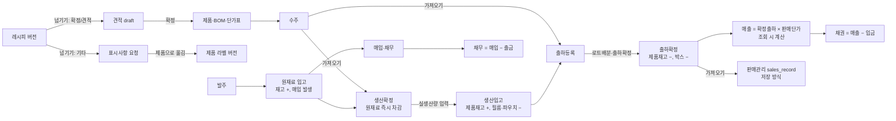
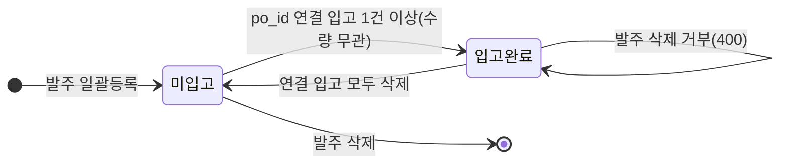
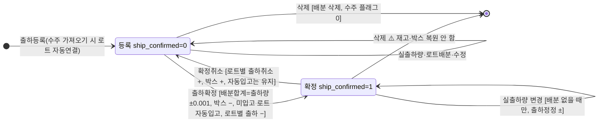

# 03. 업무 도메인별 기능·흐름·규칙

최종 정리: 2026-09-18 · 근거 줄 번호는 `MES_프로토타입_20260916/` 기준

Java로 옮길 때 **그대로 재현해야 할 규칙**과 **옮기기 전에 결정하거나 고쳐야 할 결함**을 도메인별로 정리했다. API 전체 목록은 [reference/api-inventory.md](reference/api-inventory.md), 화면과의 연결은 [04. 화면·메뉴 매핑](04-screen-map.md)을 본다.

표기: ✅ 보존할 규칙 · ⚠️ 결함/위험(고칠지 결정 필요) · ❓ 업무 담당자 확인 필요

---

## 0. 전체 업무 흐름



- DB에 선언된 FK는 없다. 위 연결은 id 또는 **이름 문자열**(거래처명, 제품 표시명 `이름(규격)`, 창고명)로 이어진다.
- 매출은 **두 벌**이다. 회계의 매출·채권은 출하확정 건을 조회할 때마다 계산하고, 판매관리의 `sales_record`는 저장된 값이다. 둘은 서로 연결되지 않는다. ❓ 어느 쪽을 기준으로 삼을지 결정해야 한다.

---

## 1. 기준정보 — 제품·원재료·BOM·단가·거래처·창고

### 1-1. 코드 채번 (제품·원재료 공통)

```text
숫자로만 된 기존 코드 중 최대값 + 1 → 최소 6자리 0채움 (예: 000124). 문자가 섞인 코드는 무시.
```
- `GET /api/products/next-code`는 미리보기일 뿐 예약하지 않는다. 동시 등록은 PK 충돌 → 409.
  - **신규 시스템(2026-09-18 결정)**: 화면을 열 때 미리 받지 않고 **저장할 때 서버가 발번**한다(같은 규칙: 숫자 코드 최대값 + 1, 6자리). 같은 때 저장해 번호가 겹치면 그 시도를 통째로 취소하고 다음 번호로 다시 한다(최대 3번). 요청에 제품코드가 와도 쓰지 않고, 응답에 발번한 `product_code`를 돌려준다. 발번은 제품 INSERT 문의 `<selectKey order="BEFORE">`에서 넣기 직전에 한다(`mapper/sa/SA0001.xml` `insertProduct`, 미리 조회해 두는 쿼리 없음).
- 원재료 생성과 서버 측 견적 확정만 `BEGIN IMMEDIATE` 안에서 채번한다.

### 1-2. BOM 비율 단위 ✅ (가장 헷갈리는 규칙)

| 위치 | 단위 |
|---|---|
| API 입력 `bom[].ratio_percent`, `quotes.bom_json` | **퍼센트** (18.69) |
| `bom.ratio_percent`, `bom_change_log`, `/products/<code>/bom` 응답, `recipe_version_bom.ratio_percent` | **비율 0~1** (0.1869) — 컬럼명이 percent지만 비율 |
| 레시피 → 견적 넘기기 | 비율 ×100 해서 퍼센트로 전달 |
| 생산 필요량 | `qty × 비율` (100으로 나누지 않음) — 100kg × 0.1869 = 18.69kg |

- 배합비 합계가 100%인지는 **어디에서도 검사하지 않는다**.
- `import_data.py`는 엑셀의 BOM 비율을 단위 검증 없이 저장한다. ❓ 엑셀 원본 단위 확인 필요.

### 1-3. 원재료 매칭 (`common.find_material`, `resolve_bom`)

1. 화면이 보낸 `material_code` → 없으면 기존 BOM이 쓰던 코드(`prefer_codes`) 순으로 우선
2. 그 코드의 원재료 이름이 입력 이름과 **같을 때만** 채택
3. 아니면 같은 이름 중 **코드가 가장 작은 것**
4. 못 찾아도 BOM 행은 `material_code = NULL`로 저장된다 ⚠️ → 생산 차감·필요량·단가 연쇄·이름 변경 전파에서 **조용히 빠진다**

- 원재료 이름 **중복을 허용**한다. 같은 이름이 다른 코드로 여러 개 있을 수 있다(`test_bom_code_match.py`).
- 원재료 이름을 바꾸면 `bom.material_name`, `recipe_version_bom.material_name`에 전파된다. 입고·발주·사용 이력은 옛 이름을 그대로 둔다(의도).

### 1-4. 단가 계산식 ✅

**견적** (`common.compute_cost_fields`):
```text
material_cost = Σ(ratio% / 100 × 원재료단가)          # 화면에서 직접 입력한 단가가 있으면 그 값
markup_cost   = material_cost × markup_rate / 100      (rate 없으면 0)
loss_cost     = (material_cost + markup_cost) × loss_rate / 100
합계          = material + loss + markup + 인건비 + 포장비 + 물류비 + 마진 + 기타1~4
quotes.total_price = current_price(견적단가)가 있으면 그 값, 없으면 합계
```

**단가관리** (`POST /api/pricing/<code>`): markup·loss는 rate가 함께 올 때만 다시 계산한다. `pricing.total_price`는 **항상 원가 합계**이고, `current_price`(현재 판매단가)는 별도 칸이다.

**판매에 쓰는 단가**: `COALESCE(pricing.current_price, pricing.total_price)`. 조회 키는 제품 표시명 `이름(규격)`이다.

**반올림**: 단가 계산에서는 서버가 반올림하지 않는다(float 그대로). 표시 반올림은 화면에서 한다.

⚠️ 결함:
- **markup_cost·loss_cost는 금액으로 고정 저장된다.** BOM 변경, 원재료 단가 변경, 일괄 교체 때는 material_cost만 다시 계산하므로 rate와 금액이 어긋난다. ❓ Java에서 rate를 기준으로 항상 재계산할지 결정해야 한다.
- `total_price`의 의미가 둘이다(견적: 판매단가 포함 / 단가표: 원가 합계).
- 원재료 단가를 바꾸면 BOM의 **화면 직접 입력 단가**가 원재료 단가로 덮어써진다.

### 1-5. 원재료 단가 변경·예약

- 적용일이 오늘 이후면 `material_price_schedule`에 예약만 한다. 오늘이거나 과거면 즉시 적용한다: `materials.unit_price` 변경 → `material_price_log` 기록 → 해당 원재료를 쓰는 BOM의 단가·금액 → 해당 제품 `pricing.material_cost`·`total_price` 재계산.
- 예약은 **모든 `/api/*` 요청 앞에서** 적용된다(02 문서). ⚠️ 동시 요청이면 이중 적용과 로그 중복이 생길 수 있고, 같은 원재료에 예약이 여러 건 있으면 적용 순서가 정해져 있지 않다. 날짜 형식을 검증하지 않아 `2026/10/01`처럼 잘못 들어간 예약은 영원히 적용되지 않는다.
- BOM 저장·일괄 교체로 BOM 단가가 바뀔 때는 가격 이력이 남지 않는다.

### 1-6. 제품 관리

| 기능 | 규칙 |
|---|---|
| 등록 `POST /api/products/register` | 코드·이름 필수, 거래처는 `clients`에 등록된 이름이어야 함(정규화 비교 + 유사 이름 제안). products + bom + pricing(`total_price = material_cost`, current_price NULL)을 한 트랜잭션으로 생성 |
| 정보 수정 `/info` | 이름·보관·거래처만 수정. ⚠️ storage를 보내지 않으면 NULL로 지워짐. `pricing.client_name`은 동기화되지 않음 |
| BOM 교체 `POST /bom` | 전체 삭제 후 다시 넣기, `bom_change_log`에 old/new 기록(비율 단위) |
| 사용안함(단종) | 행은 남기고 `discontinued=1` + 시각·처리자·사유. **재고가 0이 아니면 거부**(음수 포함). 목록·자동완성에서 빠짐 |
| 부자재 설정 | 필름·파우치·박스 원재료 코드, 파우치 내용량(kg), 파우치 길이(m), 개당 파우치 수. 원재료의 `sub_category`가 정확히 '필름'/'파우치'/'박스'여야 함 |
| 알레르기 | BOM 원재료의 `allergens`를 `,·/`로 나눠 중복 제거 |

### 1-7. 거래처 (`clients`, 거래처BOM)

- 분류(`client_type`)는 `매입`, `매출`, `매입+매출` 중 하나다. 판정은 `LIKE '%매출%'` 식이다.
- 사업자번호는 10자리 체크섬(가중치 1,3,7,1,3,7,1,3,5)을 검증하고 `XXX-XX-XXXXX` 형식으로 저장한다.
- **거래처명 단일 출처 원칙** ✅: 제품·견적·수주·출하는 거래처BOM에 등록된 이름만 받는다(`test_client_single_source.py`). 수주·생산·출하는 추가로 **매출** 분류여야 한다. ⚠️ 판매관리 직접 등록, 회계 전표의 `client_name`, 출하 수정, 견적 수정은 이 검증을 하지 않는다.
- 엑셀 업로드는 열 순서가 고정(14열)이다. 이름이 같으면 값이 있는 칸만 덮어쓴다. ⚠️ 문제가 있는 행은 건너뛰고 나머지는 커밋한다(docstring의 "통째로 되돌림"과 다름). 숫자 셀은 앞자리 0이 사라질 수 있다.
- ⚠️ 거래처 이름을 바꿔도 다른 테이블로 전파되지 않는다(이름 문자열로 연결되어 있음). 수정할 때 이름 중복 검사가 없어 UNIQUE 위반이 500으로 난다. 삭제할 때 사용 여부를 검사하지 않는다.

### 1-8. 창고

- 원재료에만 창고 개념이 있다. 입고창고(`is_receiving=1`)는 정확히 하나다. 기본 시드는 계량창고·자재창고.
- 창고별 재고: 이동 대상 창고 = 그 창고로 옮긴 양의 합계, 입고창고 = 총재고 − 옮긴 양. **창고이동은 총재고를 바꾸지 않는다**(계량실 사용분은 차감하지 않음).
- 창고 이름을 키로 쓴다. 이름을 바꾸면 materials·재고조정·입고의 창고명은 바뀌지만 ⚠️ **이동 기록(`material_warehouse_move`)은 바뀌지 않아** 계량창고 재고가 사라진 것처럼 보인다.

---

## 2. 영업 — 견적·수주

### 2-1. 견적 (`quotes`)

상태: `draft` → `confirmed` (`confirmed_product_code` 기록).

**실제 화면의 확정 경로** (05-quote.js → 04-product.js)는 요청 3개로 나뉘어 있어 원자적이지 않다:
1. 견적을 조회해 제품등록 화면을 미리 채운다 → 원재료 이름 불일치 확인 팝업
2. `POST /api/products/register` (제품·BOM·단가표 생성)
3. `POST /api/quotes/<id>/mark-confirmed`
4. `POST /api/pricing/<code>`로 견적의 rate·원가·견적단가(current_price)를 반영

서버에는 단독 확정 API `POST /api/quotes/<id>/confirm`도 있지만 화면에서 쓰지 않는다. 이 API는 계산 결과도 다르다(견적의 total_price를 그대로 복사).

⚠️ 중간에 실패하면 제품은 생성됐는데 견적은 draft로 남고, 다시 확정하면 제품이 중복된다. 확정된 견적도 삭제된다. 견적 수정은 거래처 검증을 하지 않는다.
→ **Java 방침: 확정을 단일 트랜잭션 서비스 하나로 합치고, 계산은 화면 경로(B)의 결과를 기준으로 삼는다.**

### 2-2. 수주 (`sales_order`)

| 필드 | 의미 |
|---|---|
| `order_date`, `sort_order` | 수주일, 같은 날짜 안의 순번(`BEGIN IMMEDIATE`로 채번) |
| `production_date`, `logistics_date` | 생산 예정일, 출하 예정일 |
| `is_stock_production` | 재고생산이면 `logistics_date`를 강제로 NULL. 아니면 출하일 필수 |
| `imported_production` / `imported_shipment` | 생산스케줄 / 출하로 가져갔는지 표시 |
| `order_qty` | TEXT(예: `100kg`) |

- 거래처는 거래처BOM에 있고 분류가 '매출'이어야 한다. 저장할 때 거래처BOM의 표기로 바꿔 저장한다.
- ⚠️ 가져오기 표시(`mark-imported`)는 가져오는 요청과 별개로 호출된다. 권한표에 `logistics`가 빠져 있어 물류 담당만 있으면 403이 난다. 생산·출하 행을 지우면 같은 수주에서 나온 다른 행이 남아 있어도 플래그를 0으로 되돌린다. 수주 삭제 시 연결된 생산·출하를 검사하지 않는다.

---

## 3. 생산

### 3-1. 생산확정 (`production_schedule`)

| 동작 | 규칙 |
|---|---|
| 등록 | 거래처 검증(빈 값이면 재고생산으로 허용), `sort_order` 채번, `lot_no` 발급, `product_code`는 표시명이 하나로 정해질 때만 저장, **BOM 비율만큼 원재료를 즉시 차감**(`production_material_usage` 기록), 같은 수주에서 나온 미연결 출하행에 `lot_id` 연결 |
| 수정 | 사용분 전량 복원 → 새 값으로 다시 차감(치환 유지). 품목이 바뀌면 lot_no 재발급. ⚠️ 보내지 않은 필드는 NULL로 덮어쓴다(PUT 방식). 생산일은 바꿀 수 없다 |
| 삭제 | 원재료 복원, 확정된 출하가 있으면 `출하취소`(+), 실생산량이 있으면 `생산취소`(−), 수주 플래그 0, 치환 삭제. ⚠️ 필름·파우치·박스는 되돌리지 않는다. 이 로트를 가리키는 출하 배분이 남는다 |
| 실생산량 `actual-qty` | `delta = 새 값 − 기존 값` → 제품 원장(생산입고/생산정정/입고취소), 필름·파우치 차감. `actual_qty`는 **문자열 그대로** 저장. ⚠️ 숫자 0을 보내면 "비움"(입고취소)으로 처리된다 |

- ✅ 원재료는 **생산확정을 등록할 때** 차감한다(실생산이나 투입 시점이 아님). 복원할 때는 현재 BOM으로 다시 계산하지 않고 **기록된 사용량**을 기준으로 한다.
- ⚠️ 원재료를 차감할 때는 저장된 `product_code`가 아니라 **표시명으로 제품을 다시 찾는다**(같은 표시명이면 첫 행). 투입지시서·치환 검증은 코드를 우선한다 → 서로 다른 제품을 볼 수 있다. ⚠️ 등록 API가 본문의 `actual_qty`를 그대로 INSERT하면 원장에 반영되지 않는다. ⚠️ 음수 재고를 막지 않는다.

### 3-2. 로트 번호 ✅

```text
YYYYMMDD-NN   (날짜 = 생산일, NN = 같은 생산일 + 같은 제품 표시명 안에서 기존 최대값 + 1, 100 이상은 3자리)
```
- 등록 시 `BEGIN IMMEDIATE` 안에서 발급한다. UNIQUE 제약은 없다. 최대 번호의 건을 지우면 그 번호가 재발급된다.
- 옛 자료는 기동할 때 소급 부여된다(`schema.ensure_lot_no_column`).

### 3-3. 원재료 치환 (이번 생산건만 다른 원재료 사용)

- 제품 BOM은 그대로 두고 `production_material_substitution`에 기록한다. 원래 비율로 대체 원재료를 차감한다.
- 검증: 두 코드가 모두 있어야 하고 서로 달라야 함, 대체 원재료가 존재해야 함, 원래 원재료가 BOM에 있어야 함, 이미 치환한 원재료가 아니어야 함.
- 처리 순서: 전량 복원 → 치환 기록 → 다시 차감. 치환 취소도 같은 패턴이다(`test_material_substitute.py`).

### 3-4. 포장 부자재 ✅

| 부자재 | 투입 시점 | 계산 | 되돌리는 경우 |
|---|---|---|---|
| 필름(m) | 생산입고 delta 발생 시(수동·자동 모두) | 봉지 수 = delta_kg ÷ 파우치 내용량, 필름 = 봉지 수 × 파우치 길이 | 실생산량 정정·비움 (⚠️ 생산 삭제 시는 안 됨) |
| 파우치(EA) | 같음 | 봉지 수 × 개당 파우치 수(기본 1) | 같음 |
| 박스(EA) | 출하확정 | 확정할 때 입력받은 `box_qty` | 확정취소 (⚠️ 출하·생산 삭제 시는 안 됨) |

봉지 수를 올림하지 않아 소수로 차감된다. 설정이 없으면 조용히 건너뛴다.

### 3-5. 생산가능확인 (`/api/production/feasibility`)

읽기 전용 시뮬레이션이다. 원재료 코드별로 `Σ(qty × 비율)`을 합산하고, 그 날짜 재고(= 현재고 − 그 날짜 이후 증감)와 비교해 `shortage = max(0, 필요량 − 재고)`를 구한다. 부자재는 제외한다(`test_production_check.py`).

---

## 4. 구매·재고

### 4-1. 발주 → 입고 → 반품



- 발주: 상태 컬럼이 없다. 입고 여부는 `EXISTS(material_receiving.po_id)`로 조회할 때마다 계산한다. 수정 API가 없어 삭제 후 다시 등록한다. ⚠️ 부분입고도 "입고완료"로 표시된다.
- 입고 `POST /api/materials/receiving/bulk`:
  - 한 번에 여러 줄을 처리한다. 거래처·수량·원재료가 비었거나 잘못된 줄은 **조용히 건너뛴다**. 단가가 없는 입고 줄이 하나라도 있으면 **전체 400**.
  - 과세구분은 `과세`/`면세`/`영세`이고 모르는 값은 과세로 처리한다.
  - 창고는 입고창고로 넣는다. 재고는 `+qty`.
- 금액 ✅:
  ```text
  공급가 = round(단가 × 수량)      세액 = round(공급가 × 세율)   (과세 0.1, 면세·영세 0)
  합계 = 공급가 + 세액             반품은 모두 음수
  ```
  **Python `round`는 은행가 반올림(HALF_EVEN)이다.** Java에서는 `BigDecimal.setScale(0, RoundingMode.HALF_EVEN)`을 써야 기존 값과 일치한다.
- 반품: `is_return=1`, 수량은 음수, `return_of_id`로 원 입고를 가리킨다. 누적 반품량은 원 입고량을 넘을 수 없다. 반품 줄에는 바코드를 만들지 않는다.
- 원재료 로트 바코드: `품목코드 숫자 오른쪽 6자리` + `_` + `YYMMDD` + `순번 2자리`(같은 원재료·같은 입고일 COUNT+1, 99에서 멈춤). ⚠️ COUNT 방식이라 입고를 지우면 번호가 겹칠 수 있고 UNIQUE 제약도 없다.
- ⚠️ 입고를 삭제할 때 거기에 달린 반품과 이후 재고 소진을 확인하지 않는다(고아 반품, 음수 재고 발생).

### 4-2. 원재료 재고 변동 원천

| 원천 | 테이블 | 날짜 기준 |
|---|---|---|
| 입고·반품 | `material_receiving` | receive_date |
| 생산 사용 | `production_material_usage` | 생산일(schedule_date) |
| 수동 입출고·부자재 차감 | `material_stock_movement` | ⚠️ **처리일(created_at)** |
| 재고조정 확정 | `material_stock_schedule` (applied=1) | effective_date |

**그 날짜 이후 변동 `Δ_after(d)`** = 위 4개 원천에서 날짜가 d보다 뒤인 것의 합이다. 과거 시점 재고는 `현재고 − Δ_after(d)`로 되감아 구한다.

**수불대장** ✅ (`/api/purchase-stock-range`, `test_purchase_batch.py`):
```text
전일재고 = 현재고 − Δ_after(시작일 − 1)
남은재고 = 현재고 − Δ_after(종료일)
항등식: 남은재고 = 전일재고 − 사용 + 입고 + 조정
```
안전재고보다 적으면 `추천 발주량 = base_order_qty 또는 (안전재고 − 현재고)`이다. ⚠️ 일별 수불 `/api/purchase-stock`은 옛 계산식이라 기간 수불과 값이 다르다.

### 4-3. 재고조정 (실사 업로드 → 확정)

1. 엑셀 업로드: A열 코드, B열 이름, **D열 실사수량** → `*_stock_schedule`(applied=0). 원재료는 파일 전체에 창고 하나를 지정한다.
2. 대기 목록에서 수량 수정(`edited_qty`), 개별 삭제, 전체 삭제.
3. 확정: 반영일을 받고, 원재료는 **사유 필수**. **대기건 전체**를 반영한다.
   ```text
   최종재고 = (edited_qty ?? 업로드 수량) + 반영일 이후 변동분
   ```
   제품은 원장에 `재고조정`으로 기록한다. 원재료는 `stock_qty`를 직접 설정하고 schedule 행이 이력이 된다.

⚠️ 업로드한 사람과 무관하게 대기건 전체가 확정된다(배치 ID 없음). 엑셀 코드 셀이 숫자면 `123` ≠ `000123`이라 건너뛴다. 원재료 수동 조정 방식이 세 가지(`/stock`, `/movement set_qty`, 실사 확정)인데 되감기 규칙과 이력 기록이 서로 다르다. **Java에서는 조정 서비스 하나와 원장 하나로 통일한다.**

### 4-4. 제품 재고 원장 ✅ (`common.move_product_stock`)

`products.stock_qty`와 `product_stock_movement`를 같은 함수 안에서 함께 갱신한다. **불변식: Σ 원장 qty = products.stock_qty** (`test_product_stock_ledger.py`).

| kind | 부호 | 발생 |
|---|---|---|
| 생산입고 / 생산정정 / 입고취소 | + / ± / − | 실생산량 입력·정정·비움 (moved_on = 생산일) |
| 생산취소 | − | 생산건 삭제 |
| 출하 / 출하취소 / 출하정정 | − / + / ± | 확정, 확정취소, 확정 후 실출하량 변경 (moved_on = 출하일) |
| 재고조정 | ± | 실사 확정 (moved_on = 반영일) |

⚠️ 재고를 먼저 읽고 Python에서 새 값을 계산해 UPDATE하므로, 트랜잭션 밖에서 읽는 경로에서는 **갱신 유실**이 생길 수 있다. Java에서는 `UPDATE ... SET stock_qty = stock_qty + ?`로 갱신한 뒤 같은 트랜잭션 안에서 다시 읽어 `balance_after`를 기록한다.

### 4-5. 창고이동 (바코드)

바코드(입고 바코드 또는 원재료 코드)로 조회 → 봉수 입력 → `qty = 단위중량 × 봉수`. 자재창고 잔량을 넘으면 거부한다. 도착 창고를 비우면 입고창고가 아닌 창고가 하나뿐일 때 그곳으로 옮긴다. ⚠️ 잔량 확인과 INSERT 사이에 트랜잭션이 없다.

---

## 5. 물류·출하

### 5-1. 출하 행의 두 출처

| 출처 | 테이블 | 날짜 | 수량 우선순위 |
|---|---|---|---|
| 출하등록에서 직접 넣은 행(`manual`) | `logistics_schedule` | schedule_date | actual_qty → order_qty |
| 출하일이 있는 생산행(`production`) | `production_schedule` | logistics_date | logistics_actual_qty → actual_qty → order_qty |

직접 등록한 행이 어떤 생산행을 로트로 가리키고 그 생산행이 미확정이면, 목록에서 생산행을 숨긴다(중복 표시 방지, `test_lot_pick_planned.py`).

### 5-2. 출하 상태 전이



### 5-3. 출하확정 규칙 ✅

1. 박스 수량 저장
2. 로트배분이 있으면 `|Σ배분 − 출하량| > 0.001`일 때 400 (`test_lot_allocation.py`)
3. **자동 생산입고**: 연결된 로트의 실생산량이 비어 있으면 `min(출하량, 계획량)`을 생산입고로 처리한다(필름·파우치도 차감). 사람이 이미 입력한 값은 덮어쓰지 않는다. **출하를 취소해도 자동입고는 되돌리지 않는다**(`test_auto_receive_on_ship.py`).
4. 로트마다 `출하` 원장을 한 줄씩 기록한다.
5. 차량·포장방법·방문순서·기사·용차 정보·금액을 저장하고 `ship_confirmed=1`로 바꾼다.

- 이미 확정된 상태에서 다시 확정하거나 취소된 상태에서 다시 취소하면 재고는 움직이지 않는다(현재 상태를 보고 판단).
- 로트배분은 사용자가 `{lot_id, qty}`로 직접 지정한다. **FIFO 자동배분은 없다.** 로트 잔량은 저장하지 않고 조회할 때 계산하며, 음수도 허용한다.

⚠️ 결함 (우선순위순):
1. **확정된 출하를 삭제해도 제품 재고·박스를 되돌리지 않는다.** 매출에서는 빠지고 재고만 영구히 줄어든다.
2. 출하등록 시 로트를 자동 연결하면서 생산행 `logistics_actual_qty`에 `"{:g}kg"` 누계를 적는다. 폐기된 방식이고, 기동할 때마다 보정(`clear_stale_lot_shipped_tally`)이 지운다 → 서버 재시작 전후로 값이 다르고, 로트 잔량이 이중 차감될 수 있다.
3. 확정 후 출하·생산을 수정(수량·품목·출하일)해도 재고를 정정하지 않는다.
4. 제품코드를 찾지 못하면 재고는 그대로 두고 `ship_confirmed=1`만 저장한다.
5. 로트배분을 저장할 때 로트 존재 여부, **품목 일치**, 잔량을 검사하지 않는다. 옛 `/lot` API는 확정 후에도 로트를 바꿀 수 있다.
6. 생산행 출하확정은 출하일이 있는지 검사하지 않는다(재고만 빠지고 매출에는 잡히지 않음).

### 5-4. 이월 (금액만 다음 청구로, 재고는 그대로) ✅

- `delivery_carryover(schedule_type, schedule_id, qty, unit_price, amount, original_date, target_date, target_month)`
- 원래 기간에서는 이월 수량을 빼고, 0.0001 이하가 되면 그 행을 뺀다. 대상 기간에는 이월 행을 넣되 **날짜는 실제 출고일**로 표시한다. 원본이 현재 확정 상태일 때만 매출에 반영한다(`test_carryover_date.py`).
- ⚠️ 이월 가능 잔량과 단가를 **화면이 보낸 값**으로 계산한다. 이월 취소 API가 없다.

---

## 6. 판매·회계

### 6-1. 매출 (회계 기준, 조회 시 계산) ✅

```text
매출 행 = 출하확정(ship_confirmed=1) 건
수량   = parse_qty_number(수량 문자열) − 이월 수량
단가   = COALESCE(current_price, total_price)  (키: 제품 표시명)
금액   = 수량 × 단가   (반올림 없음, 부가세 없음 — supply/vat는 None)
```

### 6-2. 매입 (입고 기준)

입고 등록이 곧 매입이다(확정 단계 없음). 금액은 저장된 `total_amount`(**부가세 포함**)를 쓴다.

### 6-3. 채권·채무

```text
채권 = 매출(부가세 제외, 계산값) − 입금(acc_transaction kind='입금')
채무 = 매입(부가세 포함, 저장값) − 출금(kind='출금')
기초잔액 = 시작일 전날까지 누적. 같은 날짜에서는 거래가 먼저, 수금·지급이 나중.
```

❓ **채권은 부가세 제외, 채무는 부가세 포함으로 기준이 다르다.** 입금은 보통 부가세 포함 금액이므로 채권 잔액이 실제보다 적게 나올 수 있다. 관리부 확인이 필요하다.

### 6-4. 입출금 전표·기초회계

- `acc_transaction`: kind(입금/출금), 날짜, 거래처명(자유 입력 ⚠️), 계정과목, 금액(>0), 수단(현금·계좌·카드·어음·기타), 계좌·카드, 작성자 **이름**.
- 계정과목: 기동할 때 32개를 기본으로 넣는다. 자산·비용이면 차변, 그 외는 대변으로 자동 지정한다. ⚠️ 사용 중인 과목도 삭제된다(주석은 "비활성화"라고 적었으나 실제 코드는 삭제). 카드·계좌 삭제도 전표 사용 여부를 보지 않는다.
- 카드는 **뒤 4자리만** 저장한다.
- ⚠️ `POST /api/accounting/payments`(채권대장의 바로 입금)는 금액이 0 이하여도 저장한다. `/transactions`는 거부한다.
- 권한은 kind별로 라우트 안에서 다시 검사한다(매출/매입, 입금/출금, 채권/채무).

### 6-5. 판매관리 (`sales_record`, 저장 방식)

- 출하확정 후보를 가져와서 저장한다(`source_type, source_id` 부분 UNIQUE로 이중 등록 방지). 서버가 금액을 다시 계산하며 화면 값을 믿지 않는다. 직접 등록(`manual`)도 된다.
- ⚠️ 이월을 반영하지 않는다. 직접 등록할 때 거래처·품목 마스터 검증이 없다. 회계 매출·채권과 연결되지 않는다.
- 토탈집계: 생산입고(금액 없음) + 판매를 한 표로 보여준다.

### 6-6. 거래명세표·세금계산서

- 거래명세표: **확정 여부와 무관하게** 출하등록된 모든 건을 보여주고, 이월 규칙은 매출과 같다. 출력물에는 부가세 칸이 없고 공급자 정보가 하드코딩되어 있다.
- 세금계산서: 발행 API가 **501 미구현**이다. 발행용 데이터 모델도 없다. ❓ 이번 전환 범위에 포함할지 결정해야 한다.

---

## 7. 상품개발 (레시피)

- 구조: 업체 폴더(`recipe_clients`) → 레시피(`recipe_drafts`) → 버전(`recipe_versions`: 초안, test1, test2 …) → 배합표(`recipe_version_bom`, **비율 0~1**).
- 권한: `recipe_permission` 등급 viewer < download < upload. 관리자는 모두 통과한다. 모든 레시피 API는 권한표 대신 라우트 안에서 검사한다.
- **잠금** ✅: 버전의 `stage`(신규확정/견적공유/기타공유)에 값이 있으면 수정할 수 없다(403).
- **넘기기(handoff)** ✅ — 한 트랜잭션:
  - 확정·견적: `quotes`에 draft를 만든다(비율×100, `total_price = material_cost`). `source_recipe`는 텍스트다.
  - 기타: `label_requests`에 `requested`를 만든다(배합표 초안 텍스트 포함).
  - 버전을 잠그고 단계 로그를 남긴다. 같은 버전을 같은 종류로 두 번 넘기면 400, 배합표가 비었으면 400.
- 새 test 버전: `test{n}`(n = test로 시작하는 버전 수 + 1). **id가 가장 큰 버전**의 배합표를 복사한다(화면에서 보던 버전이 아님).
- 공유: **관리자만** 사원에게 기한을 정해 공유한다. 공유 시점의 버전으로 고정된다. 공유받은 사람은 `/shared-view`로 본다.
- ⚠️ `stage`를 빈 값으로 보내면 upload 등급이면 누구나 잠금을 풀 수 있다. 레시피를 삭제할 때 잠금을 확인하지 않고, handoff·견적·요청이 고아로 남는다.

---

## 8. 라벨 (식품표시사항)

- 제품별 버전(`product_label_versions`). 상태는 `is_current`(사용중) **하나뿐**이다. `products`의 라벨 컬럼은 사용중 버전의 **복사본**이다.
- 항목 9개(식품유형, 내용량, 원재료명, 알레르기, 품목보고번호, 포장재질, 소비기한 수·단위, 보관방법) + 양식별 추가 항목 `extra`(JSON) + 레이아웃.
- 양식(`label_templates`): 열 폭 합계가 종이 가로와 ±0.51mm 이내여야 하고, rowspan/colspan 격자에 넘침·겹침·빈칸이 없는지 검사한다. 기본 크기 100×150mm.
- 마크 이미지는 data URL로 DB에 저장한다(400KB 이하).
- 표시사항 요청(`label_requests`, 레시피에서 넘어옴) → 제품의 사용중 버전으로 옮긴다(**빈 항목은 건너뜀**) → `done`.
- 라벨 출력: 날짜별 생산 행, 제품의 최근 생산일.
- ⚠️ 양식·마크·항목이 쓰이는지를 **JSON 문자열 LIKE**(`'"mark_id": 5'`, 콜론 뒤 공백)로 검사한다. Jackson은 공백 없이 직렬화하므로 **그대로 옮기면 검사가 모두 실패**한다. 참조 테이블이나 JSON 파싱으로 바꿔야 한다.
- ⚠️ 버전 목록 GET이 사용중 버전이 없으면 최신 버전을 사용중으로 **UPDATE**한다.
- ⚠️ 제품 라벨 저장은 항목을 모두 덮어쓰고(PUT), 요청 옮기기는 빈 항목을 건너뛴다(PATCH). 두 동작을 구분해야 한다.

---

## 9. 문서함·첨부

- `attachment(scope, ref_id)`: scope가 `receiving`이면 입고 서류(ref_id = 입고 id), `document`면 문서함(ref_id = 폴더 id, **TEXT**).
- 저장: `data/uploads/{scope}/{ref_id}/{epoch_ms}_{safe_name}`. 파일당 30MB, 요청 64MB. **확장자·MIME 제한이 없다.**
- 폴더 권한은 최상위 폴더를 따른다: 공용+부서 없음 = 전사, 공용+부서 = 그 부서, 개인 = 본인. 관리자는 모두 통과한다. 관리자가 아닌 사람이 공용 폴더를 만들면 본인 부서로 강제된다.
- 잠금: 폴더 비밀번호(Werkzeug 해시), 423 + `locked_folder_id`. 해제 상태는 세션에 저장된다(로그아웃 전까지).
- 공유: 파일 공유는 **내 개인문서만** 가능하다. 폴더 공유는 읽기 전용이다. 기한이 있고, 공유하면 메신저 1:1 알림이 간다.
- ⚠️ **파일 공유를 받으면 폴더 잠금까지 우회**하지만 폴더 공유는 잠금을 존중한다. 정책을 확인해야 한다. 같은 밀리초에 같은 파일명이 들어오면 덮어쓴다(UUID 권장).

## 10. 메신저

- 1:1방(`dm_key = 작은id_큰id`, 부분 UNIQUE)과 단체방(비밀번호 선택). 멤버라면 누구나 초대할 수 있다.
- 파일은 **JSON 안의 base64**로 받는다(50MB라고 되어 있으나 실제로는 64MB 요청 제한 때문에 약 48MB까지). 저장 경로 `data/chat_files/{room_id}/…`를 DB에 **절대 경로**로 저장한다. ⚠️ `chat_files`는 백업 대상이 아니다.
- 폴링 주기: 열린 방 3초, 방 목록 8초, 배지 8초.
- ⚠️ 잠긴 방의 비밀번호를 **GET 쿼리스트링**으로 매 요청 보낸다. 방 나가기·삭제 API가 없다. 처음 열면 최근 50건만 보인다.

## 11. AI·온도

- AI: 수요예측(최근 12개월 월별 최소자승 선형), 재고부족 경고(30일 평균 사용량 기준 남은 일수 <7 위험, <14 주의), 채팅(키워드 규칙 답변 우선, 아니면 Anthropic `claude-sonnet-4-5` 또는 Gemini, 도구 `get_business_data`로 **집계값만** 전달), 이미지 생성(Gemini).
  - ⚠️ 채권 합계를 폐기된 `client_payments`에서 읽어 실제보다 크게 나온다. Gemini 키가 URL 쿼리에 들어간다. 모델명이 하드코딩되어 있다.
- 온도: RadioNode(타파쿨로365) `channel/get_lst` 조회, 프로세스 캐시 20초. 센서 키는 `device_mac|sensor_mac|ch_no`. **이력은 저장하지 않는다.**
  - ⚠️ 화면 타이머가 항상 `force=1`로 호출해 캐시를 건너뛴다(호출 제한 위험). min/max에 빈 문자열이 들어가면 비교할 때 500.

## 12. 인사·근태

- 사원(`employees`): 인사정보와 로그인 계정이 한 테이블에 있다. 주민번호는 Fernet 암호화, 목록에는 마스킹(`YYMMDD-N******`), 전체 조회는 별도 API.
- 계정 설정·회수는 관리자만 한다. 로그인 가능한 마지막 관리자는 회수할 수 없다. ⚠️ 사원 **물리 삭제**에는 이 보호가 없다. is_admin을 부여하는 API가 없다(관리자는 시드 계정뿐).
- 연차 ✅ (근로기준법 60조, 입사일 기준, `test_leave.py`):
  ```text
  근속 1년 미만: min(11, 꽉 채운 개월 수)   (매달 개근 가정, accruing=true)
  근속 N년(N≥1): min(25, 15 + (N−1) // 2)
  연차연도 = 입사일 + N년 ~ 다음 기념일 전날.  2월 29일 입사자는 평년에 2월 28일로 봄
  사용 = 연차연도 안의 leave_records.days 합계 (0.5 또는 1, 같은 날 합계 ≤ 1)
  잔여 = 발생 − 사용 (음수 허용)
  ```
  잔여 부족, 주말·공휴일, 퇴사일 이후 사용은 검사하지 않는다.

## 13. 대시보드

- 메모: 공용 메모와 내 개인 메모. ⚠️ **공용 메모는 누구나 수정·삭제할 수 있다.**
- 공휴일: 코드에 2025~2027만 하드코딩되어 있다(신규 React 달력도 같은 JSON).
- 요약 숫자, 용차 합계.

---

## 14. Java 이식 공통 체크리스트

| # | 항목 | 방침 |
|---|---|---|
| 1 | 검증 실패 시 롤백 | Flask는 "commit하지 않고 close"로 롤백한다. Spring에서는 **예외를 던진다**(오류 응답을 return하면 commit됨) |
| 2 | 재고 갱신 | 원자적 UPDATE(`stock = stock + ?`) + 같은 트랜잭션에서 원장 기록 |
| 3 | 상태 전이 멱등성 | `UPDATE ... SET ship_confirmed=1 WHERE id=? AND ship_confirmed=0` → 영향받은 행 수 확인 |
| 4 | 채번 | sort_order, lot_no, 바코드, 코드 → 잠금 또는 시퀀스 + UNIQUE 제약 |
| 5 | 수량 | TEXT 수량 → `BigDecimal` + 단위 칸. 이관할 때만 `parse_qty_number` 규칙 사용(첫 숫자 토큰, 쉼표 제거, **부호 무시**). 해석 실패 목록을 보고서로 남긴다 |
| 6 | 반올림 | 매입 금액은 HALF_EVEN. 매출·단가는 반올림하지 않음 → 정책을 정하고 대조 테스트 |
| 7 | 제품 식별 | 표시명 `이름(규격)` 매칭 → `product_code`로 통일. 코드 NULL·표시명 중복 행은 사람이 확정 |
| 8 | 부분 수정 | 생산·출하·제품·원재료 수정의 "보내지 않은 필드 = NULL" 동작을 유지할지(PUT), PATCH로 바꿀지 API별로 결정 |
| 9 | 읽기 스냅샷 | 수불대장·시점재고·생산가능확인은 `@Transactional(readOnly=true)` 하나로 조회 |
| 10 | 삭제 API | 존재·사용 여부를 확인하지 않고 항상 `{ok:true}`인 곳이 많다 → 404/409 정책 결정 |
| 11 | 날짜·시간 | `Asia/Seoul` 고정. 입력 날짜 형식 검증(현재는 잘못된 형식이 500 또는 조용한 오동작) |
| 12 | 회귀 기준 | 기존 테스트 49개의 기대 결과를 Java 테스트로 옮긴다(목록은 [reference/ui-and-test-inventory.md](reference/ui-and-test-inventory.md)) |

## 15. 업무 담당자 확인이 필요한 질문 (❓ 모음)

1. 매출 기준: 회계 계산 매출과 판매관리 `sales_record` 중 무엇이 기준인가?
2. 채권을 부가세 포함으로 볼 것인가? (현재 채권은 부가세 제외, 채무는 포함)
3. 확정된 출하 삭제, 확정 후 수정을 허용할 것인가? 허용한다면 재고를 되돌려야 하는가?
4. 로트배분에서 다른 품목 로트, 잔량 초과를 막을 것인가?
5. 원가 항목(markup·loss)은 금액 고정인가, 비율 기준 재계산인가?
6. 레시피 잠금을 upload 등급 사용자가 풀 수 있어야 하는가?
7. 파일 단위 공유가 폴더 잠금을 우회하는 것이 의도인가?
8. 세금계산서 실제 발행(팝빌)을 이번 범위에 넣는가?
9. 공용 대시보드 메모를 누구나 수정·삭제할 수 있어야 하는가?
10. BOM 엑셀(`import_data.py`) 비율은 퍼센트인가, 비율인가?

---

## 부록: 도메인별 테이블

| 도메인 | 테이블 |
|---|---|
| 제품·BOM·단가 | product_types, materials, products, bom, pricing, bom_change_log, material_price_log, material_price_schedule |
| 견적·수주·판매 | quotes, sales_order, sales_record |
| 생산 | production_schedule, production_material_usage, production_material_substitution |
| 물류·출하 | logistics_schedule, shipment_lot_allocation, packing_methods, vehicles, delivery_carryover |
| 재고·창고 | product_stock_movement, product_stock_schedule, material_stock_schedule, material_stock_movement, warehouses, material_warehouse_move |
| 구매 | material_purchase_order, material_receiving, material_supplier |
| 거래처 | clients, client_payments(폐기, 이관용) |
| 상품개발 | recipe_clients, recipe_drafts, recipe_versions, recipe_version_bom, recipe_shares, recipe_stage_logs, recipe_handoffs, label_requests |
| 라벨 | label_company_info(단일 행), label_templates, label_marks, label_fields, product_label_versions |
| 회계 | acc_subject, acc_bank_account, acc_card, acc_transaction |
| 문서 | document_folder, attachment, document_share |
| 메신저 | chat_rooms, chat_room_members, chat_messages |
| 인사 | employees, leave_records |
| 설정·기타 | external_api_settings, app_settings(미사용), temp_sensors, temp_groups, dashboard_memos |

부서 테이블과 공휴일 테이블은 없다(부서 = `employees.department` DISTINCT, 공휴일 = 코드 하드코딩). 컬럼 상세는 [reference/database-schema.md](reference/database-schema.md).
