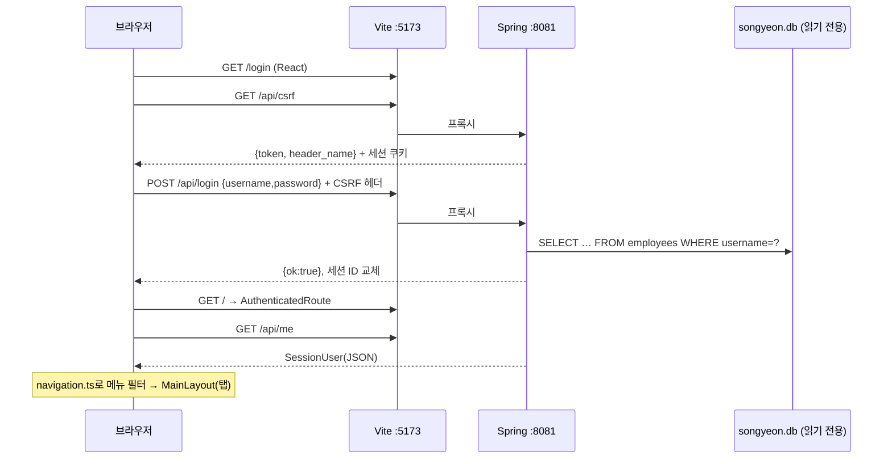

# 06. 신규 시스템(현재 구현) 구조와 작업 방법

최종 정리: 2026-09-18 · 대상 `backend/`, `frontend/`

지금 있는 코드가 **어떻게 동작하는지**와 **새 화면·API를 어떻게 추가하는지**를 정리했다. 앞으로 따를 기준은 [05. 목표 구조](05-target-architecture.md)이고, 현재 코드와 목표의 차이는 이 문서 5장에 있다.

## 1. 전체 흐름



## 2. 백엔드 (`backend/`)

### 2-1. 파일

| 파일 | 역할 |
|---|---|
| `MesApplication` | 진입점. 기본 사용자 자동 설정(`UserDetailsServiceAutoConfiguration`) 제외 |
| `auth/SecurityConfig` | 폼·Basic 로그인 끔, 세션 저장소 `HttpSessionSecurityContextRepository`, CSRF `HttpSessionCsrfTokenRepository`. 허용: `GET /api/health`, `GET /api/csrf`, `POST /api/login`. 인증 필요: `GET /api/me`, `POST /api/logout`. **그 밖은 모두 거부(denyAll)**. 401·403은 JSON `{error}` |
| `auth/AuthController` | `/api/health`, `/api/csrf`, `/api/login`, `/api/me`, `/api/logout` |
| `auth/AccountRepository` + `SqliteAccountRepository` | `employees`에서 id·username·name·department·password_hash·permissions(JSON)·is_admin·recipe_permission 조회. `jdbc:sqlite:…?mode=ro`, 호출마다 새 연결(`DriverManager`, 풀 없음). DB 파일이 없으면 기동 실패 |
| `auth/WerkzeugPasswordVerifier` | `scrypt:N:r:p$salt$hex`(64바이트), `pbkdf2:sha256:iter$salt$hex`(32바이트) 검증. 파라미터 상한 검사, 상수 시간 비교 |
| `auth/LoginAttemptLimiter` | IP별 실패 누적: 5회 60초, 10회 5분, 20회 30분. 잠금 해제 후 15분 동안 실패가 없으면 기록 삭제. 최대 1만 IP, 메모리 저장 |
| `auth/SessionUser` | 세션 주체이자 `/api/me` 응답. 비밀번호 해시·주민번호는 넣지 않음 |
| `auth/ApiErrors` | 전역 예외 처리: JSON 파싱 오류는 400, **`IllegalStateException`은 모두 503 "로그인 정보를 조회할 수 없습니다"** |
| `application.yml` | `127.0.0.1:8081`, 세션 12시간, 쿠키 `SONGYEON_SESSION`(HttpOnly, SameSite=Lax, Secure=`SONGYEON_HTTPS`), 오류 메시지·스택 비노출, **Jackson `SNAKE_CASE` 전역**, 기본 비밀번호·계정 DB 경로, 업무 DB(PostgreSQL) 접속·`mybatis.mapper-locations` |
| `common/security/RequirePermission`·`LoginOnly`·`PermissionInterceptor`·`PermissionChecker`, `common/config/WebConfig` | 업무 API 권한 검사: 컨트롤러 클래스에 `@RequirePermission("화면권한")`, 로그인만 필요한 메서드는 `@LoginOnly`. 메서드 실행 전에 검사(관리자 통과, 권한 키 중 하나라도 있으면 통과 — 기존 any-of). 실패 시 403 |
| `common/web/ApiResponse` | 업무 API 공통 응답 봉투 `{success, message, data}` ([05 문서 3-1](05-target-architecture.md#3-1-응답-봉투-적용-2026-09-18-사내-다른-프로젝트의-resultresponse-방식-참고)) |
| `controller/sa`·`service/sa`·`dao/sa`·`dto/sa` + `mapper/sa` | 영업관리 6개 화면(SA0001~SA0006). 기준 예시는 단가관리(`SA0002Controller`·`SA0002Service`·`SA0002DAO`·`SA0002DTO`·`SA0002.xml`) |

### 2-2. 로그인 처리 순서 (`AuthController.login`)

1. IP 잠금 확인 → 잠겨 있으면 429 `{error, locked_seconds}` + `Retry-After`
2. 아이디 trim, 빈 값·길이 초과(아이디 200자, 비밀번호 1024자) → 400
3. 계정 조회. **계정이 없어도 더미 scrypt 해시로 같은 연산을 수행**(응답 시간으로 계정 존재를 추측하지 못하게 함 — 레거시에는 없는 방어)
4. 실패 → 실패 횟수 +1, 401
5. 성공 → 기록 삭제, `password_is_default` 계산(입력값 == 설정된 기본 비밀번호), 권한 `ROLE_ADMIN`/`ROLE_USER`, **세션 ID 교체**, 보안 컨텍스트 저장, 새 CSRF 토큰 발급

### 2-3. 테스트 (`.\run.cmd test`, 16개)

| 테스트 | 내용 |
|---|---|
| `AuthIntegrationTest` (4) | CSRF·인증 필수, 로그인 시 세션 ID 교체와 로그아웃 시 무효화, 5회 실패 후 429, 잘못된 JSON 400 |
| `LoginAttemptLimiterTest` (1) | 단계별 잠금·만료·성공 시 초기화 |
| `SqliteAccountRepositoryTest` (2) | 조회해도 DB 파일이 바뀌지 않음, SQL 주입 문자열, DB 파일이 없으면 새로 만들지 않음 |
| `WerkzeugPasswordVerifierTest` (5) | Python으로 만든 벡터 4개(영문·한글 × scrypt·pbkdf2), 잘못된 형식·과도한 파라미터 거부 |
| `SA0002DAOTest` (2) | H2 메모리 DB로 XML·DAO·DTO 연결, 제품코드 순 정렬, 제품명·코드·거래처 검색(대소문자 무시) |
| `SA0002ControllerTest` (2) | 비로그인 401, 권한 키 없으면 403(기존 문구), 관리자 통과, 응답 JSON 키가 기존과 같은 `product_code` 형식 |

`E2eApplication`(테스트 클래스패스 전용)은 임시 DB를 만들어 8089 포트로 띄운다. Playwright가 사용한다.

## 3. 프런트엔드 (`frontend/`)

### 3-1. 파일

| 위치 | 역할 |
|---|---|
| `routes/AppRouter.tsx` | `window.location.pathname`으로 분기: `/login` → LoginPage, `/` → AuthenticatedRoute, 그 외 404 안내. **React Router는 없다** |
| `routes/AuthenticatedRoute.tsx` | `useSession`으로 `/api/me` 조회 → 성공하면 `MainLayout`, 401이면 `/login`으로 이동 |
| `routes/pageRegistry.tsx` | `Map<메뉴ID, 컴포넌트>` — 현재 `dashboard`, `product`, `pricing` 등록. 없으면 "준비 중" 안내 |
| `shared/config/screenMeta.ts`, `MainLayout/screenMetaContext.ts` | 화면 제목 오른쪽 설명(기존 문구 그대로). 화면이 `useScreenMeta()`로 바꿀 수 있음(예: 단가관리 "제품 0건") |
| `shared/config/navigation.ts` | 분류 11개·메뉴 목록(레거시 순서·ID 그대로) + `visibleCategories(user)`(관리자 전체, 일반 계정은 권한 키 + 별칭 규칙) |
| `shared/components/layout/MainLayout/` | 사이드바(사용자·로그아웃·테마·분류·메뉴), 탭(`WorkspaceTabs`), 본문. **열린 탭을 모두 마운트한 채 `hidden`으로 전환**하므로 탭을 옮겨도 입력이 유지된다. 기본 비밀번호 경고, 메신저 버튼(준비 중) |
| `.../hooks/useWorkspace.ts` | 열린 탭·활성 탭·분류 상태. 대시보드 탭은 닫을 수 없음 |
| `.../hooks/useTheme.ts` | 야간모드, localStorage `songyeon-theme`(레거시와 같은 키) |
| `shared/components/Dialog/` | 네이티브 `<dialog>` 모달(ESC·배경 클릭 닫기) |
| `shared/services/authService.ts` | `request()`(same-origin 쿠키, 15초 타임아웃, `{error}` 파싱, `LoginError`), `post()`는 **매번 `/api/csrf`를 먼저 호출**, `login/getCurrentUser/logout` |
| `shared/hooks/useSession.ts` | 사용자 조회·로그아웃 |
| `pages/auth/` | 로그인: 아이디 trim, Enter로 다음 칸 이동, 중복 제출 방지, 429 카운트다운 |
| `pages/dashboard/` | 시작 안내 + 달력(월 이동, 오늘, 기념일 JSON 2025~2027), 날짜 클릭 시 메모 팝업(저장 버튼 비활성) |
| `pages/sa/SA0001/` | 제품등록: 기존 문구·배치 그대로. 기본정보 6칸 + BOM 행(빈 행 3개 시작) 추가·삭제·초기화, 적용단가 계산, 저장 전 검사. `store/productFormStore.ts`(useReducer). 서버 값(제품코드·포장유형 목록)과 저장·엑셀은 미연결 |
| `pages/sa/SA0002/` | 단가관리: 기존 문구·배치 그대로. 거래처 유사도 필터·차액금 필터/정렬, 단가상세 창(고정마진·로스 계산, 포장유형 값 채우기). 서버 값(제품 수는 0건, 목록·상세)과 검색·저장·엑셀은 미연결 |
| `styles/` | global·auth·common CSS. 색상 변수·다크 테마 |

### 3-2. 테스트 (`npm.cmd test`, Playwright 15개 — 아래 3개 파일 + `SA0002.spec.ts` 2개)

| 파일 | 개수 | 내용 |
|---|---:|---|
| `login.spec.ts` | 8 | 빈 입력, 401 표시, 429 카운트다운, 중복 제출·공백 처리, 네트워크 오류, **실제 Spring 세션으로 로그인·새로고침·로그아웃**, CSRF 없는 요청 거부, 320px 폭 |
| `dashboard.spec.ts` | 3 | 분류 11개·달력·추석 표시·메모 팝업, 탭 중복·닫기·야간모드 유지, 일반 계정 메뉴·360px 폭 (`/api/me`는 모의 응답) |
| `SA0001.spec.ts` | 2 | 입력·행 조작·탭 간 유지·닫으면 초기화·**업무 API 요청이 없음**, 360px·야간모드 |

`dashboard`·`product` 테스트는 실행할 때마다 `docs/screenshots/*.png`를 다시 찍는다.

## 4. 새 화면·API를 추가하는 방법

### 4-1. 지금 당장 (현재 코드 기준) — 화면만 추가

1. `src/pages/<업무>/<기능>/XxxPage.tsx` 생성 (업무 폴더명은 [05 문서 2-1 표](05-target-architecture.md#2-1-패키지-트리))
2. 필요하면 같은 폴더에 `components/`, `hooks/`, `store/`, `types/`
3. `routes/pageRegistry.tsx`에 `['메뉴ID', XxxPage]` 추가 — 메뉴ID는 `navigation.ts`에 이미 있다(43개)
4. `tests/xxx.spec.ts`에 Playwright 테스트 추가
5. [04 문서](04-screen-map.md)의 해당 행 상태를 🟡로 바꾼다

### 4-2. 업무 API를 붙이기 전에 먼저 해야 할 공통 작업

아래를 하지 않고 업무 API를 붙이면 나중에 모든 화면을 다시 고쳐야 한다. 순서대로 진행한다.

| 순서 | 작업 | 이유 |
|---|---|---|
| 1 | JSON 키 형식 결정: 현재 `SNAKE_CASE`는 MyBatis(DB `product_code` → Java `productCode`)와는 문제없이 동작하고 기존 파이썬 응답·화면 타입과 같다. s-erp 응답 봉투(`resultCode`)를 도입할 때만 camelCase 전환이 필요 | 화면 타입 파일과 함께 결정 |
| 2 | `common/web`(ResultVO·ResponseCode), `common/exception/GlobalExceptionHandler`, 보안 오류도 봉투로 | 현재 `ApiErrors`가 모든 `IllegalStateException`을 로그인 오류(503)로 바꾼다 |
| 3 | `auth` → `common/security` + `auth/controller·service·domain` 재배치 (테스트 12개 유지) | 패키지 규칙 |
| 4 | ~~`PermissionChecker`~~ **완료(2026-09-18)**. 남음: `/api/me`에 공유 건수 두 필드 추가 | 서버 권한 검사 |
| 5 | ~~MyBatis·DataSource 설정~~ **완료(2026-09-18)**. 남음: PostgreSQL DB 생성·접속 확인 | 업무 DB |
| 6 | 프런트 `shared/services/apiClient.ts` + `authService` 축소 | 업무 API 공통 처리 |
| 7 | 공용 부품: useDialog·toast, PageHeader·SearchArea·MessageArea, DataGrid(또는 F1-Grid 결정) | 화면마다 중복 구현 방지 |

### 4-2-1. 영업 4개 화면의 서버 API (2026-09-18, 화면 미연결·DB 연결 전)

제품등록·단가관리·견적·수주등록 화면이 쓰는 기능을 모두 만들어 두었다. 검증 문구와 계산은 기존 파이썬과 같다. 검증에 실패하면 예외를 던지고, 그때까지 저장한 내용은 모두 취소된다. `SaApiIntegrationTest`는 H2(PostgreSQL 모드)에서 Controller→XML 전체를 실제로 실행해 확인한다.

**화면 단위 원칙**: 한 화면이 부르는 API는 그 화면 패키지(`sales/<화면>/controller·service·dao·dto` + `mapper/sales/<화면>/*.xml`)에 모두 둔다. 선택 목록(원재료·포장유형·거래처)도 화면마다 자기 주소와 자기 SQL로 받는다. 여러 화면이 함께 쓰는 공통 조회 패키지는 두지 않는다. 권한은 그 화면의 권한 키 하나로 검사한다. DB를 쓰지 않는 순수 계산만 `common/util`에 둔다.
- `SimilarText`: 파이썬 difflib와 같은 유사도
- `ClientNameUtil`: "혹시 '(주)부산축산' 인가요?" 안내 문구
- `NumberUtil`: 기존 `float()` 규칙

| 화면 | 기능 | 새 주소 | 기존 파이썬 | 권한 |
|---|---|---|---|---|
| 제품등록 | 원재료 자동완성 | `GET /api/sa/sa0001/materials` | `/api/materials/names` | 로그인 |
| | 원재료명 확인 | `POST /api/sa/sa0001/materials/check` | `/api/materials/check` | product |
| | 포장유형·거래처 목록 | `GET /api/sa/sa0001/product-types`, `/clients` | `/api/product-types`, `/api/client-master` | product |
| | 제품 등록(+견적 확정) — 제품코드는 저장할 때 발번해 응답 `product_code`로 | `POST /api/sa/sa0001` | `/api/products/next-code`(화면 열 때) + `/api/products/register` → `/api/quotes/<id>/mark-confirmed` → `/api/pricing/<code>` | product || 단가관리 | 목록·제품 수 | `GET /api/sa/sa0002?q=`, `/summary` | `/api/pricing`, `/api/summary` | pricing (제품 수는 로그인) |
| | 상세·저장(보낸 항목만) | `GET·PUT /api/sa/sa0002/{code}` | `GET·POST /api/pricing/<code>` | pricing |
| | 포장유형·거래처 목록 | `GET /api/sa/sa0002/product-types`, `/clients` | `/api/product-types`, `/api/client-master` | pricing |
| 견적 | 목록·상세 | `GET /api/sa/sa0003`, `/{id}` | `/api/quotes` | quote |
| | 작성·수정·삭제 | `POST /api/sa/sa0003`, `PUT·DELETE /{id}` | `POST /api/quotes`, `POST·DELETE /<id>` | quote |
| | 원재료·포장유형·거래처 목록 | `GET /api/sa/sa0003/materials`, `/product-types`, `/clients` | `/api/materials/names`, `/api/product-types`, `/api/client-master` | quote (원재료는 로그인) |
| 수주등록 | 날짜별 목록 | `GET /api/sa/sa0004?date=` | `/api/sales-order?date=` | order |
| | 등록·수정·삭제 | `POST /api/sa/sa0004`, `PUT·DELETE /{id}` | `POST /api/sales-order`, `POST·DELETE /<id>` | order |
| | 매출 거래처·품목 후보 | `GET /api/sa/sa0004/clients`, `/products` | `/api/clients/sales-names`, `/api/products/order-candidates` | order |
| 출하등록 | 날짜별 목록 | `GET /api/sa/sa0005?date=` | `/api/logistics-schedule?date=` | shipment |
| | 등록(+수주 가져감 표시) | `POST /api/sa/sa0005` | `POST /api/logistics-schedule` → `/api/sales-order/<id>/mark-imported` | shipment |
| | 실출하량 | `PUT /api/sa/sa0005/{id}/actual-qty`, `/production/{id}/actual-qty` | `POST /api/logistics-schedule/<id>/actual-qty`, `/api/production-schedule/<id>/logistics-actual-qty` | shipment |
| | 삭제 | `DELETE /api/sa/sa0005/{id}` | `DELETE /api/logistics-schedule/<id>` | shipment |
| | 로트 배분 조회·저장 | `GET·PUT /api/sa/sa0005/{id}/lot-allocation` | `GET·POST /api/logistics-schedule/<id>/lot-allocation` | shipment |
| | 로트 목록(품목명으로) | `GET /api/sa/sa0005/lots?product_name=` | `/api/products/stock` + `/api/products/<code>/lots` | shipment |
| | 생산예정 수주·가져올 수주 | `GET /api/sa/sa0005/planned-orders?product_name=`, `/import-orders?start=&end=` | `/api/sales-order?product_name=&pending_only=1`, `?start=&end=&date_field=logistics&pending_only=1` | shipment |
| | 매출 거래처·품목 후보 | `GET /api/sa/sa0005/clients`, `/products` | `/api/clients/sales-names`, `/api/products/order-candidates` | shipment |
| 생산가능확인 | 제품 목록(BOM 있는 것) | `GET /api/sa/sa0006/products` | `/api/products/with-bom`(화면에서 거름) | prod-check |
| | 확인(그 날짜 재고로 되는지) | `GET /api/sa/sa0006?date=&product=..&qty=..` | `/api/production/feasibility` | prod-check |

- **응답은 공통 봉투** `{success, message, data}`로 감싼다(2026-09-18). 기존 파이썬 응답 내용은 `data` 안에 있고 키 이름은 같다(`product_code`, `total_price` …). 기존의 `{ok: true}`는 `success`로, 오류 `{error}`는 `message`로 바뀌었다. 수정은 기존 `POST /<id>` 대신 `PUT /{id}`.
- **견적 확정**:
  - 기존에는 제품등록 화면이 등록 → 견적 확정 표시 → 원가 반영을 따로 세 번 불렀다. 지금은 제품 등록 요청에 `quote_id`와 `quote_costs`(견적의 원가 항목)를 함께 보내 한 번에 처리한다.
  - 중간에 실패하면 모두 취소된다. 견적이 이미 지워졌다면 제품도 등록되지 않는다.
  - 기존에는 이 과정에 `pricing` 권한도 필요했지만, 이제 `product` 권한만 있으면 된다.
- **기존 권한과 달라진 점**: 기존에는 목록 API 하나를 여러 화면이 함께 썼다. 예를 들어 `/api/pricing`은 quote·product·acc-sales 권한으로도 조회됐다. 지금은 화면마다 자기 권한으로만 조회된다. 다른 화면에 같은 목록이 필요하면 그 화면을 옮길 때 그 화면 패키지에 만든다.
- **다른 화면에서 만들 기능**: 수주의 기간·미가져감 조회와 가져감 표시는 화면마다 자기 패키지에 둔다. 출하등록은 `/api/sa/sa0005/import-orders`·등록 때 가져감 표시로 만들었고, 생산확정은 그 화면을 옮길 때 만든다.
- **출하등록에서 기존과 달라진 점**:
  - 권한: 기존에는 출하 **저장**에 `logistics` 권한이 필요해서 출하등록 메뉴 권한(`shipment`)만 있으면 조회만 되고 저장이 막혔다. 지금은 모두 `shipment`로 검사한다.
  - 수주에서 가져온 줄: 기존에는 등록 뒤 화면이 수주 "가져감 표시"를 따로 불렀다. 지금은 등록 한 번에 처리하고, 실패하면 둘 다 취소된다.
  - 출하확정된 줄: 기존 서버는 실출하량 수정(재고를 차이만큼 다시 맞춤)과 삭제(재고는 되돌리지 않음)를 허용했다. 화면은 "출하확정됨 — 수정불가"로 막고 있다. 지금은 서버도 "출하확정된 건은 수정할 수 없습니다"·"출하확정된 건은 삭제할 수 없습니다"로 막는다. 재고를 다시 맞추는 일은 출하확정 화면(재고 원장 포함)을 옮길 때 그 화면에서 처리한다.
  - 기존 로트 배분 저장은 예전 방식 연결을 배분 표에 한 줄 넣었다가 곧바로 지우는 동작(결과적으로 아무것도 바꾸지 않음)을 했다. 이 동작은 옮기지 않았다.
  - 기존 동작을 그대로 둔 부분: 로트가 자동 연결되면 그 로트(생산확정 줄)의 물류 실출하량에 출하량을 더한다(`1500kg` 모양). 배분 합계와 실출하량이 맞는지는 서버에서 검사하지 않는다(화면만 검사).
- **생산가능확인**:
  - 그 날짜 재고는 지금 재고에서 그 날짜 뒤의 입고·생산 사용·수동 조정·재고조정을 되감아 구한다. 계산 방식은 기존 `material_delta_after` 그대로다.
  - 제품 목록은 기존에 화면이 `/api/products/with-bom` 전체를 받아 BOM 없는 제품을 걸렀다. 지금은 서버가 걸러서 이름(규격)만, 한글 순으로 준다.
  - `product`·`qty`는 같은 이름으로 여러 번 온다. 값이 하나일 때 Spring이 쉼표로 쪼개지 않도록(`2,000kg`) 온 그대로 읽는다.
- 기존 동작을 그대로 둔 부분(개선 여부는 [03 문서](03-business-rules.md)에서 결정):
  - 견적 수정은 제품명·거래처 검사를 하지 않는다.
  - 단가 저장의 거래처명은 검사하지 않는다.
  - 수주 정렬번호는 동시에 등록하면 겹칠 수 있다.
- 테이블·컬럼 이름은 기존 SQLite 그대로다. PostgreSQL 스키마를 만들 때 이름이 바뀌면 XML만 고친다.

### 4-3. 기능 하나를 완성하는 단위 — 기준 예시: 단가관리 목록 조회 (`SA0002`)

MyBatis 설정(`pom.xml`, `application.yml`의 `spring.datasource`·`mybatis`)과 기준 예시 한 세트를 2026-09-18에 만들어 두었다. 새 화면은 `SA0002Controller`·`SA0002Service`·`SA0002DAO`·`SA0002DTO`·`mapper/sa/SA0002.xml`을 복사해 화면코드만 바꿔 시작한다.

흐름: `GET /api/sa/sa0002?q=` → (로그인: `SecurityConfig`, 권한: 클래스의 `@RequirePermission("pricing")`을 `PermissionInterceptor`가 검사) → `SA0002Controller`(`return ApiResponse.ok(…)`) → `SA0002ServiceImpl`(`@Transactional`) → `SA0002DAO`(`dao/`, `@Mapper` 인터페이스) → `resources/mapper/sa/SA0002.xml` → `PricingDTO`(`dto/`). 업무코드(`sa`, `cm` …) 아래 주소는 `common/web/BusinessApi`에 등록돼 있어 로그인만 하면 열린다(그 밖은 기본 거부). 테스트도 `SA0002DAOTest`(H2 메모리 DB로 XML 확인), `SA0002ControllerTest`(권한·JSON 모양)를 복사해 쓴다.

```text
backend/src/main/java/kr/co/songyeon/mes/
  controller/sa/SA0001Controller.java  (@RequirePermission("권한키"), return ApiResponse.ok(…))
  service/sa/SA0001Service.java        (@Service 클래스 하나, @RequiredArgsConstructor, @Transactional)
  dao/sa/SA0001DAO.java                (@Mapper 인터페이스)
  dto/sa/SA0001DTO.java                (화면당 DTO 하나, @Getter @Setter, 필드 모두)
backend/src/main/resources/mapper/<업무코드>/<화면코드>.xml                (예: mapper/sa/SA0001.xml)
backend/DATABASE/YYYYMMDD/…sql, _change.md, _rollback.sql   (스키마 변경 시)
frontend/src/pages/<업무코드>/<화면코드>/                               (예: pages/sa/SA0001)
  SA0001Page.tsx, components/…, services/xxx.service.ts, types/xxx.types.ts
frontend/src/shared/config/navigation.ts  (메뉴에 code: 'SA0001'), routes/pageRegistry.tsx (['SA0001', SA0001Page])
frontend/tests/SA0001.spec.ts
routes/pageRegistry.tsx 등록
테스트: 서비스 단위·통합(레거시 테스트 기대값) + Playwright
문서: 04 추적표 상태 ✅, 03 규칙 중 이관 완료 표시
```
첫 기능(제품+BOM)을 이 형태로 완성한 뒤, 그것을 정본으로 s-erp 방식의 생성 스킬을 만든다.

## 5. 현재 코드와 목표의 차이 (정리 대상)

| 영역 | 현재 | 목표 | 우선 |
|---|---|---|---|
| JSON 키 | SNAKE_CASE 전역 | camelCase | 높음 |
| 응답 형식 | 원시 객체 `{ok}`, `SessionUser`, 오류 `{error}` | 봉투 `{resultCode, resultMessage, result}` | 높음 |
| 예외 처리 | `ApiErrors` 2개 핸들러(IllegalState → 503 로그인 문구) | `GlobalExceptionHandler` | 높음 |
| 패키지 | `auth` 한 패키지에 설정·컨트롤러·저장소·예외 처리 | `common/*` + 업무별 계층 | 높음 |
| DB 연결 | 업무 DB: **MyBatis + PostgreSQL 설정 완료**(DB 생성 전). 계정 조회만 아직 SQLite `DriverManager` | 계정 조회도 PostgreSQL 이관 후 MyBatis로 | 중간 |
| 권한 | `PermissionChecker`(기존 any-of + 관리자 통과) 추가, 단가관리 조회에 적용 | 업무 API마다 적용 | 높음 |
| `/api/me` | shared_recipe_count·shared_document_count 없음 | 추가 | 중간 |
| 비밀번호 변경 | 없음(버튼은 준비 중 안내) | `POST /api/me/password` (8자 이상, 기본값·현재값과 다름) | 중간 |
| 퇴사자 로그인 | 막지 않음(레거시와 같음) | `resign_date`가 있으면 거부 | 중간 |
| CSRF 토큰 | 변경 요청마다 `/api/csrf` 선조회 | 캐시 + 403 시 재조회 | 낮음 |
| apiClient | 인증 전용 `request()` | 공용 apiClient | 높음 |
| 라우팅 | pathname 분기, 새로고침하면 탭 초기화 | 탭 URL 동기화 여부 결정 | 낮음 |
| "서버 연결됨" 표시 | 고정 문구 | 실제 상태 확인 또는 제거 | 낮음 |
| 공휴일 | 정적 JSON 2025~2027 | 서버 API(2028년 이후 대비) | 낮음 |
| 프런트 단위 테스트 | 없음 | Vitest | 중간 |
| 서버 바인딩 | 127.0.0.1 (이 PC에서만 접속) | 운영 시 사내망 접근 구성(리버스 프록시 권장) | 배포 전 |
| 로그인 시도 제한 | IP 기준 → Vite·리버스 프록시 경유 시 모든 사용자가 한 IP로 합산됨 | 프록시 신뢰 설정(X-Forwarded-For) 또는 아이디+IP 기준 | 배포 전 |
| 세션 저장 | 서버 메모리(재시작 시 전원 로그아웃) | 필요 시 Spring Session JDBC | 배포 전 |
